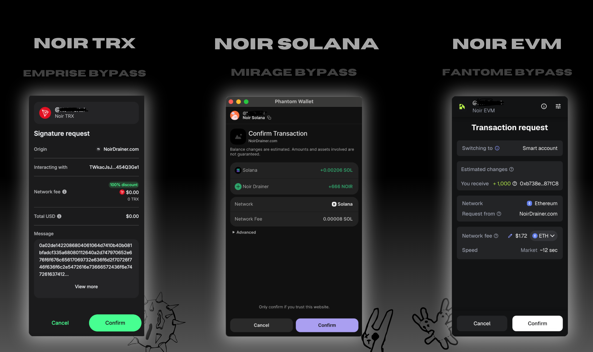

# NOIR

## L'Art du Drainage 🕵️‍♂️

---

### Why NOIR? 🤔

Most drainers break at the worst moment — big wallets, lots of tokens, slow confirmations. **We don't.**

#### Key Features 🌟:

- **Zero Failed Transactions**: Parallel bundle processing guarantees every TX lands on-chain. No more "blockhash expired." No missed profits.
- **Fat Wallet Support**: Handles 600+ tokens without issues.
- **Smart Priority System**: Drains the most valuable assets first. Victim disconnects mid-drain? You already got the big ones.
- **Lightning Execution ⚡**: Asset scan (~2 seconds), full drain (~4 seconds).

---

### Bypass Technology 🛡️

#### Solana — Mirage Bypass 🪄

- Proprietary TOCTOU bitflip bypasses Phantom Lighthouse.
- Clean popup: No warnings or "malicious dApp" flags.
- "+0.00001 SOL" — looks like a harmless airdrop.
- One click = full drain.

#### EVM — Fantome Bypass 🧙‍♂️

- EIP-7702 smart account upgrade drains all assets in a single click.
- Chains: ETH, BSC, Polygon, Arbitrum, Base, Optimism, Avalanche.
- "Switching to Smart account" — looks like a wallet upgrade.
- "You receive +1,000" — fake token airdrop.
- One click = every token drained.

#### Tron — Emprise Bypass 🌀

- Proprietary bypass for TRON wallets.
- Details omitted for brevity.

---

### Contact Us 📞

For more details, join our Telegram: [Click Here](https://t.me/f_factus)

---
